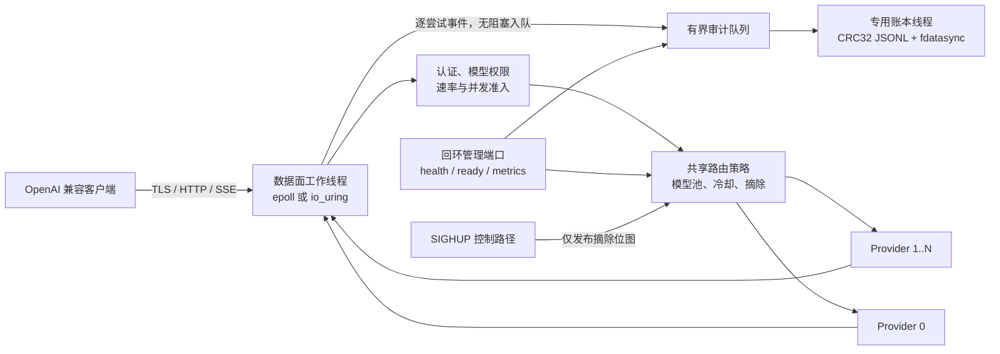
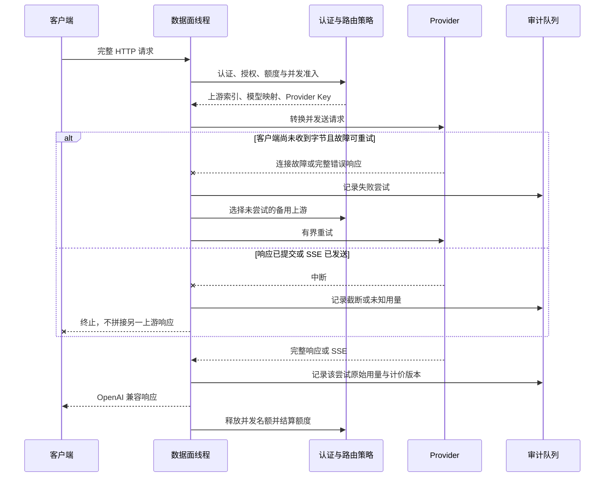

# AI-llm-transplot 架构与请求路径

本文描述本分支的单机部署边界。数据面保持事件驱动；认证、路由、额度和审计通过 `gateway::Policy`、`RequestSink` 等接口接入，不在网络热路径读取文件或访问外部数据库。

## 生命周期与所有权

- `main` 启动时完整解析配置、解析 DNS、装载价目表并重放账本；任一严格校验失败都不启动工作线程。
- 每个数据面工作线程拥有自己的连接和事件循环。不可变上游配置在工作线程存活期间保持有效，不跨线程转移 Socket 所有权。
- `RoutingPolicy`、指标和用户额度由工作线程共享；可变字段使用原子操作。`SIGHUP` 只原子发布固定上游表的摘除位图，不替换正在使用的配置对象。
- 请求日志与审计账本各自使用有界队列和专用线程。队列满时不阻塞事件循环；普通请求日志可丢弃并计数，账本失败则让带额度用户 fail-closed。
- 正常停止先停止接纳新连接，再结束工作线程、排空审计队列并持久化 `session_end`。强制退出留下未闭合 session，下次启动会把相关 UTC 周期的额度恢复为 unknown。

## 一次请求的关键边界

默认不会重放可能已被 Provider 执行的非幂等请求。只有显式启用 `routing.allow_unsafe_replay`，并且客户端尚未收到响应字节时，完整的 `408`、`429`、`5xx` 才可切换；这不提供跨 Provider 恰好一次语义。

## 部署边界

当前完成口径是单进程、单机保守额度。账本具有单写者锁，不能让多个实例共享一个文件；多个实例也不共享速率、额度、粘性或健康状态。管理端口固定绑定回环地址，生产入口必须启用 TLS，Provider Key 仅由服务端环境变量注入。容器与 systemd 操作见[部署说明](deployment.md)，账务限制见[用量与审计边界](accounting.md)。
